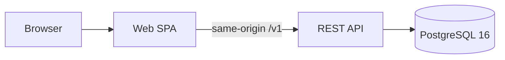

# Quick Commerce

A single-store quick-commerce app: customers browse and order, an admin manages the catalog and order status, and guests can only browse. This repository is the milestone 1 foundation. Auth, catalog, cart, and checkout behavior are later milestones. The approved design is [`docs/design.md`](docs/design.md).

## Architecture



| Package           | Role                                                                             |
| ----------------- | -------------------------------------------------------------------------------- |
| `apps/web`        | React 18, Vite, React Router, TanStack Query, Tailwind. Static build for Vercel. |
| `apps/api`        | Node 20, Express, Prisma, Zod, Pino. Container for Render.                       |
| `packages/shared` | Zod contracts shared by the API, the web client, and OpenAPI.                    |

The browser never calls the API host directly. Locally, Vite proxies `/v1`. On Vercel, `apps/web/vercel.json` rewrites `/v1` to the Render service (ADR-004). CORS is deny-all.

Money is stored and returned as integer paise. The UI will format rupees.

## Prerequisites

- Node.js 20.19 or newer (`nvm use` reads `.nvmrc`)
- npm 10
- PostgreSQL 16, or Docker with Compose
- [gitleaks](https://github.com/gitleaks/gitleaks) for the pre-commit hook

## Setup

```bash
npm ci
cp .env.example .env
# Set ADMIN_PASSWORD to 8+ characters with a letter and a number.
createdb quick_commerce            # or: node scripts/create-databases.mjs
createdb quick_commerce_test
createdb quick_commerce_shadow
npm run db:generate
npm run db:migrate
npm run db:seed
```

`node scripts/create-databases.mjs` creates the shadow and test databases when `quick_commerce` already exists.

The seed refuses an empty or weak `ADMIN_PASSWORD`. It upserts one admin (`ADMIN_EMAIL`) and sample categories, subcategories, and products. Running it again does not duplicate them.

## Run

```bash
npm run dev
```

- Web: http://localhost:5173
- API health: http://localhost:4000/v1/health
- API docs: http://localhost:4000/v1/docs

Or with Docker:

```bash
docker compose up --build
```

Compose starts Postgres, migrates, and serves the API and the Vite dev server. Seed from the host with `DATABASE_URL` pointing at `localhost:5432` and `npm run db:seed`. The Compose admin password is not set; seeding stays an explicit step.

## Test

```bash
npm run lint
npm run format:check
npm run typecheck
npm run db:drift
npm run test:coverage
npm run build
```

API integration tests apply migrations to `quick_commerce_test`. Override the URL with `TEST_DATABASE_URL`.

Playwright is configured in `apps/web` and is not run in CI yet. Specs arrive with the flows they cover.

## Environment

Copy `.env.example`. The API also reads `apps/api/.env`, which overrides the root file. Process environment wins over both.

| Variable                         | Purpose                                                                         |
| -------------------------------- | ------------------------------------------------------------------------------- |
| `DATABASE_URL`                   | PostgreSQL connection. Include `connection_limit=5` for the app pool.           |
| `SHADOW_DATABASE_URL`            | Empty database used by the migration drift check.                               |
| `TEST_DATABASE_URL`              | Database used by Vitest.                                                        |
| `JWT_SECRET`                     | At least 32 characters. Required at startup. Auth uses it in a later milestone. |
| `JOBS_TOKEN`                     | At least 16 characters. Protects the future sweep endpoint.                     |
| `ADMIN_EMAIL` / `ADMIN_PASSWORD` | Seed only. Password must be 8+ characters with a letter and a number.           |
| `DELIVERY_FEE_PAISE`             | Flat delivery fee in paise.                                                     |
| `SERVICEABLE_PINCODES`           | Comma-separated 6-digit pincodes.                                               |
| `IMAGE_HOSTS`                    | Hostnames allowed in image URLs and in `img-src`.                               |
| `DOCS_ENABLED`                   | `true` or `false`. Defaults on outside production.                              |
| `SENTRY_DSN`                     | Optional. Parsed now, wired to error tracking later.                            |
| `VITE_API_BASE_URL`              | Browser base path. Keep `/v1`.                                                  |
| `VITE_API_PROXY_TARGET`          | Where Vite proxies `/v1` during local dev.                                      |

`apps/web/vercel.json` points `/v1` at `https://quick-commerce-api.onrender.com`. Change that host when the Render service exists. Do not put production secrets in the repo.

## Deploy

Not part of this milestone. The intended path, after a deployment checkpoint:

- API and PostgreSQL 16 on Render in Singapore. `prisma migrate deploy` runs before traffic switches.
- Web on Vercel. The `/v1` rewrite keeps the refresh cookie same-origin.
- Free tiers are for dev and preview only (ADR-011).

## Troubleshooting

- **API exits on startup.** The message lists the invalid variable. `JWT_SECRET` and `JOBS_TOKEN` are required even before those features exist.
- **Seed says the password is weak.** Use 8+ characters with a letter and a number. `password1` and `change-me` are rejected.
- **`prisma generate` cannot find the client.** Run `npm run db:generate`. The client is generated into `apps/api/src/generated` and is not committed.
- **Drift check fails.** Apply migrations to `DATABASE_URL` first. `SHADOW_DATABASE_URL` must be a database the Prisma user can reset.
- **Health returns 503.** Postgres is down or `DATABASE_URL` points at the wrong database. `GET /v1/health` reports `db: down`.
- **Pre-commit fails on gitleaks.** Install the gitleaks binary and retry. The hook does not skip the scan.
- **Port 5432 is taken.** Stop the other Postgres or change the Compose port and `DATABASE_URL` together.

## Documentation

Phase and milestone documents, standards, and the approval log are indexed in [docs/README.md](docs/README.md).

## Further reading

- [Design](docs/design.md)
- [ADRs](docs/adr/README.md)
- [Contributing](CONTRIBUTING.md)
