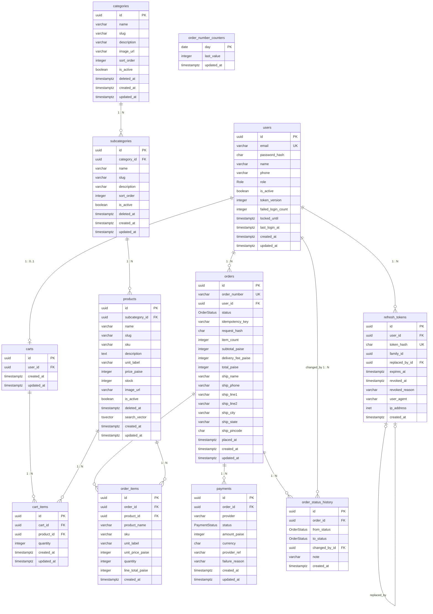
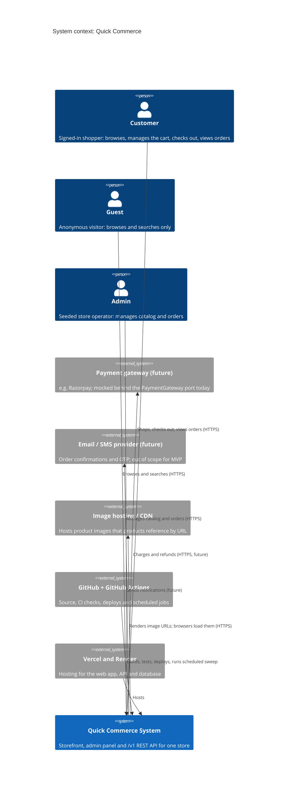
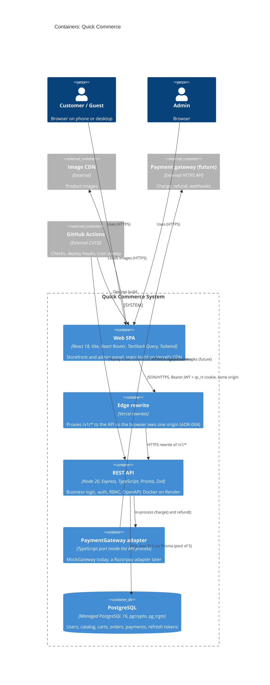
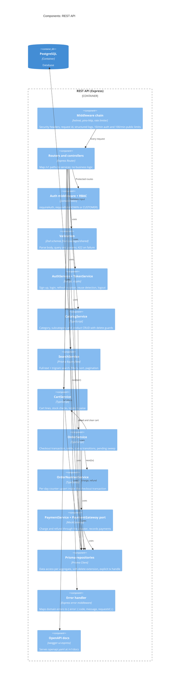
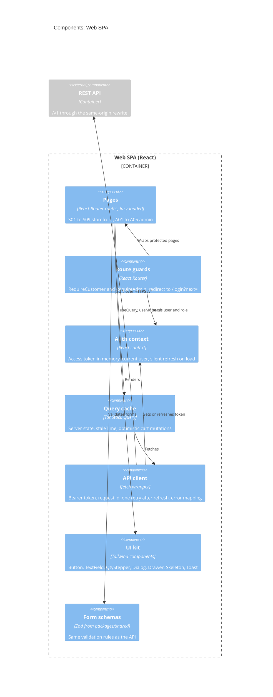
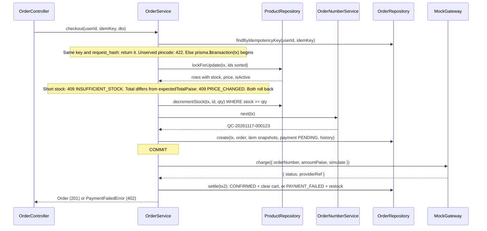
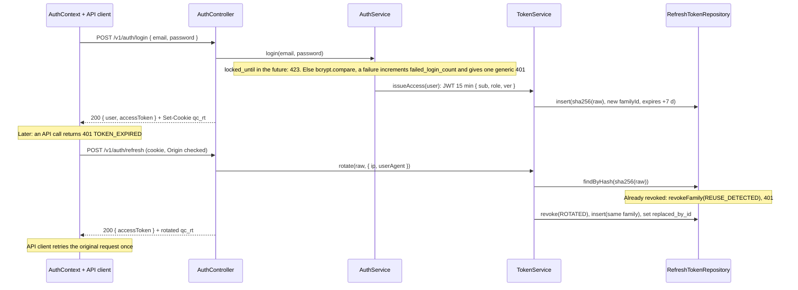
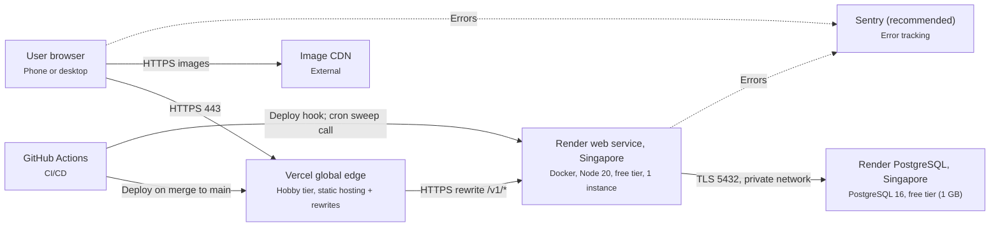

# Quick Commerce App: Detailed Design (Checkpoint 2)

**Status: Checkpoint 2 approved (Nov 17, 2026)**, with the architecture review fixes folded into the design.

Database design, API endpoint list, requirement traceability matrix, C4 architecture and review comments. Generated from the Checkpoint 2 design Page. Commit to `docs/design.md`.

## 1. Database design (PostgreSQL 16 + Prisma)

### Entity-relationship diagram



`order_number_counters` issues `orders.order_number` logically (no foreign key).

### Enums

| Enum          | Values                                                                                     | Notes                                                                   |
| ------------- | ------------------------------------------------------------------------------------------ | ----------------------------------------------------------------------- |
| Role          | ADMIN, CUSTOMER                                                                            | Guest is not stored: a request with no valid access token is a guest.   |
| OrderStatus   | PENDING_PAYMENT, PAYMENT_FAILED, CONFIRMED, PACKED, OUT_FOR_DELIVERY, DELIVERED, CANCELLED | Allowed moves are enforced in OrderService (see transitions).           |
| PaymentStatus | PENDING, SUCCEEDED, FAILED, REFUNDED                                                       | REFUNDED is set by the mock gateway when an admin cancels a paid order. |

### Table definitions

#### `users`

Admin and customer accounts. Guests are not stored.

| Column               | Type           | Nullable | Default             | Constraints and notes                                                         |
| -------------------- | -------------- | -------- | ------------------- | ----------------------------------------------------------------------------- |
| `id`                 | `uuid`         | No       | `gen_random_uuid()` | PK                                                                            |
| `email`              | `varchar(254)` | No       |                     | UNIQUE; stored lowercase                                                      |
| `password_hash`      | `char(60)`     | No       |                     | bcrypt, cost 12; never returned by the API                                    |
| `name`               | `varchar(100)` | No       |                     |                                                                               |
| `phone`              | `varchar(15)`  | Yes      |                     | E.164, e.g. +919876543210                                                     |
| `role`               | `Role`         | No       | `'CUSTOMER'`        | ADMIN only through the seed script                                            |
| `is_active`          | `boolean`      | No       | `true`              | Inactive users cannot log in                                                  |
| `token_version`      | `integer`      | No       | `0`                 | JWT ver claim; bumped on deactivation, role change and log out of all devices |
| `failed_login_count` | `integer`      | No       | `0`                 | Consecutive failures; reset on successful login                               |
| `locked_until`       | `timestamptz`  | Yes      |                     | now + 15 minutes after 5 consecutive failures                                 |
| `last_login_at`      | `timestamptz`  | Yes      |                     |                                                                               |
| `created_at`         | `timestamptz`  | No       | `now()`             |                                                                               |
| `updated_at`         | `timestamptz`  | No       | `now()`             | Prisma @updatedAt                                                             |

| Index             | Definition     |
| ----------------- | -------------- |
| `users_email_key` | UNIQUE (email) |
| `users_role_idx`  | (role)         |

#### `refresh_tokens`

Hashed refresh tokens for rotation, logout and reuse detection.

| Column           | Type           | Nullable | Default             | Constraints and notes                                              |
| ---------------- | -------------- | -------- | ------------------- | ------------------------------------------------------------------ |
| `id`             | `uuid`         | No       | `gen_random_uuid()` | PK                                                                 |
| `user_id`        | `uuid`         | No       |                     | FK users.id ON DELETE CASCADE                                      |
| `token_hash`     | `char(64)`     | No       |                     | UNIQUE; SHA-256 of the opaque token (raw token only in the cookie) |
| `family_id`      | `uuid`         | No       |                     | Shared by every token in one rotation chain                        |
| `replaced_by_id` | `uuid`         | Yes      |                     | FK refresh_tokens.id ON DELETE SET NULL                            |
| `expires_at`     | `timestamptz`  | No       |                     | Issued at + 7 days                                                 |
| `revoked_at`     | `timestamptz`  | Yes      |                     | Set on logout, rotation or reuse                                   |
| `revoked_reason` | `varchar(20)`  | Yes      |                     | LOGOUT \| LOGOUT_ALL \| ROTATED \| REUSE_DETECTED \| USER_DISABLED |
| `user_agent`     | `varchar(255)` | Yes      |                     |                                                                    |
| `ip_address`     | `inet`         | Yes      |                     |                                                                    |
| `created_at`     | `timestamptz`  | No       | `now()`             |                                                                    |

| Index                           | Definition                       |
| ------------------------------- | -------------------------------- |
| `refresh_tokens_token_hash_key` | UNIQUE (token_hash)              |
| `refresh_tokens_user_idx`       | (user_id)                        |
| `refresh_tokens_family_idx`     | (family_id)                      |
| `refresh_tokens_expires_idx`    | (expires_at) for the cleanup job |

#### `categories`

Top-level catalog groups, e.g. Dairy & Bread.

| Column        | Type            | Nullable | Default             | Constraints and notes                        |
| ------------- | --------------- | -------- | ------------------- | -------------------------------------------- |
| `id`          | `uuid`          | No       | `gen_random_uuid()` | PK                                           |
| `name`        | `varchar(80)`   | No       |                     | Unique among non-deleted (case-insensitive)  |
| `slug`        | `varchar(100)`  | No       |                     | Unique among non-deleted                     |
| `description` | `varchar(500)`  | Yes      |                     |                                              |
| `image_url`   | `varchar(2048)` | Yes      |                     | https URL on an allowlisted IMAGE_HOSTS host |
| `sort_order`  | `integer`       | No       | `0`                 |                                              |
| `is_active`   | `boolean`       | No       | `true`              | Hidden from the storefront when false        |
| `deleted_at`  | `timestamptz`   | Yes      |                     | Soft delete                                  |
| `created_at`  | `timestamptz`   | No       | `now()`             |                                              |
| `updated_at`  | `timestamptz`   | No       | `now()`             |                                              |

| Index                        | Definition                                                    |
| ---------------------------- | ------------------------------------------------------------- |
| `categories_slug_live_key`   | UNIQUE (slug) WHERE deleted_at IS NULL (raw SQL in migration) |
| `categories_name_live_key`   | UNIQUE (lower(name)) WHERE deleted_at IS NULL                 |
| `categories_active_sort_idx` | (is_active, sort_order)                                       |

#### `subcategories`

Second-level groups inside a category, e.g. Milk.

| Column        | Type           | Nullable | Default             | Constraints and notes                 |
| ------------- | -------------- | -------- | ------------------- | ------------------------------------- |
| `id`          | `uuid`         | No       | `gen_random_uuid()` | PK                                    |
| `category_id` | `uuid`         | No       |                     | FK categories.id ON DELETE RESTRICT   |
| `name`        | `varchar(80)`  | No       |                     | Unique per category among non-deleted |
| `slug`        | `varchar(100)` | No       |                     | Unique per category among non-deleted |
| `description` | `varchar(500)` | Yes      |                     |                                       |
| `sort_order`  | `integer`      | No       | `0`                 |                                       |
| `is_active`   | `boolean`      | No       | `true`              |                                       |
| `deleted_at`  | `timestamptz`  | Yes      |                     | Soft delete                           |
| `created_at`  | `timestamptz`  | No       | `now()`             |                                       |
| `updated_at`  | `timestamptz`  | No       | `now()`             |                                       |

| Index                             | Definition                                                 |
| --------------------------------- | ---------------------------------------------------------- |
| `subcategories_cat_slug_live_key` | UNIQUE (category_id, slug) WHERE deleted_at IS NULL        |
| `subcategories_cat_name_live_key` | UNIQUE (category_id, lower(name)) WHERE deleted_at IS NULL |
| `subcategories_cat_sort_idx`      | (category_id, sort_order)                                  |

#### `products`

Sellable items with price in paise and a single store stock count.

| Column           | Type            | Nullable | Default             | Constraints and notes                                        |
| ---------------- | --------------- | -------- | ------------------- | ------------------------------------------------------------ |
| `id`             | `uuid`          | No       | `gen_random_uuid()` | PK                                                           |
| `subcategory_id` | `uuid`          | No       |                     | FK subcategories.id ON DELETE RESTRICT                       |
| `name`           | `varchar(150)`  | No       |                     |                                                              |
| `slug`           | `varchar(170)`  | No       |                     | Unique among non-deleted; used in /p/:slug                   |
| `sku`            | `varchar(40)`   | No       |                     | Unique among non-deleted                                     |
| `description`    | `text`          | Yes      |                     |                                                              |
| `unit_label`     | `varchar(40)`   | No       |                     | e.g. 500 g, 1 L, 6 pc                                        |
| `price_paise`    | `integer`       | No       |                     | CHECK (price_paise > 0); Rs 1 = 100 paise                    |
| `stock`          | `integer`       | No       | `0`                 | CHECK (stock >= 0)                                           |
| `image_url`      | `varchar(2048)` | Yes      |                     | https URL on an allowlisted IMAGE_HOSTS host                 |
| `is_active`      | `boolean`       | No       | `true`              |                                                              |
| `deleted_at`     | `timestamptz`   | Yes      |                     | Soft delete                                                  |
| `search_vector`  | `tsvector`      | No       | `generated`         | GENERATED ALWAYS AS (weighted name A + description B) STORED |
| `created_at`     | `timestamptz`   | No       | `now()`             |                                                              |
| `updated_at`     | `timestamptz`   | No       | `now()`             |                                                              |

| Index                        | Definition                                                  |
| ---------------------------- | ----------------------------------------------------------- |
| `products_slug_live_key`     | UNIQUE (slug) WHERE deleted_at IS NULL                      |
| `products_sku_live_key`      | UNIQUE (sku) WHERE deleted_at IS NULL                       |
| `products_search_gin`        | GIN (search_vector) for full-text search                    |
| `products_name_trgm`         | GIN (name gin_trgm_ops) for typo-tolerant and prefix search |
| `products_subcat_active_idx` | (subcategory_id, is_active) WHERE deleted_at IS NULL        |
| `products_price_idx`         | (price_paise)                                               |
| `products_created_idx`       | (created_at DESC)                                           |
| `products_low_stock_idx`     | (stock) WHERE stock <= 5 AND deleted_at IS NULL             |

#### `carts`

One cart per customer, created on first add.

| Column       | Type          | Nullable | Default             | Constraints and notes                 |
| ------------ | ------------- | -------- | ------------------- | ------------------------------------- |
| `id`         | `uuid`        | No       | `gen_random_uuid()` | PK                                    |
| `user_id`    | `uuid`        | No       |                     | UNIQUE; FK users.id ON DELETE CASCADE |
| `created_at` | `timestamptz` | No       | `now()`             |                                       |
| `updated_at` | `timestamptz` | No       | `now()`             |                                       |

| Index               | Definition       |
| ------------------- | ---------------- |
| `carts_user_id_key` | UNIQUE (user_id) |

#### `cart_items`

Lines in a cart. Prices are read live from products until checkout.

| Column       | Type          | Nullable | Default             | Constraints and notes             |
| ------------ | ------------- | -------- | ------------------- | --------------------------------- |
| `id`         | `uuid`        | No       | `gen_random_uuid()` | PK                                |
| `cart_id`    | `uuid`        | No       |                     | FK carts.id ON DELETE CASCADE     |
| `product_id` | `uuid`        | No       |                     | FK products.id ON DELETE RESTRICT |
| `quantity`   | `integer`     | No       | `1`                 | CHECK (quantity BETWEEN 1 AND 10) |
| `created_at` | `timestamptz` | No       | `now()`             |                                   |
| `updated_at` | `timestamptz` | No       | `now()`             |                                   |

| Index                         | Definition                   |
| ----------------------------- | ---------------------------- |
| `cart_items_cart_product_key` | UNIQUE (cart_id, product_id) |
| `cart_items_product_idx`      | (product_id)                 |

#### `orders`

Placed orders with totals and a snapshot of the delivery address.

| Column               | Type           | Nullable | Default             | Constraints and notes                                                                               |
| -------------------- | -------------- | -------- | ------------------- | --------------------------------------------------------------------------------------------------- |
| `id`                 | `uuid`         | No       | `gen_random_uuid()` | PK (internal)                                                                                       |
| `order_number`       | `varchar(18)`  | No       |                     | UNIQUE; QC-YYYYMMDD-NNNNNN; public identifier                                                       |
| `user_id`            | `uuid`         | No       |                     | FK users.id ON DELETE RESTRICT                                                                      |
| `status`             | `OrderStatus`  | No       | `'PENDING_PAYMENT'` |                                                                                                     |
| `idempotency_key`    | `varchar(64)`  | No       |                     | From the Idempotency-Key header; UNIQUE with user_id                                                |
| `request_hash`       | `char(64)`     | No       |                     | SHA-256 of the checkout body; same key with a different body gets 422                               |
| `item_count`         | `integer`      | No       |                     | CHECK (item_count > 0)                                                                              |
| `subtotal_paise`     | `integer`      | No       |                     | CHECK (subtotal_paise >= 0)                                                                         |
| `delivery_fee_paise` | `integer`      | No       | `0`                 | From config DELIVERY_FEE_PAISE                                                                      |
| `total_paise`        | `integer`      | No       |                     | CHECK (total_paise = subtotal_paise + delivery_fee_paise)                                           |
| `ship_name`          | `varchar(100)` | No       |                     | Address snapshot                                                                                    |
| `ship_phone`         | `varchar(15)`  | No       |                     | 10-digit Indian mobile, stored E.164                                                                |
| `ship_line1`         | `varchar(200)` | No       |                     |                                                                                                     |
| `ship_line2`         | `varchar(200)` | Yes      |                     |                                                                                                     |
| `ship_city`          | `varchar(80)`  | No       |                     |                                                                                                     |
| `ship_state`         | `varchar(80)`  | No       |                     |                                                                                                     |
| `ship_pincode`       | `char(6)`      | No       |                     | CHECK (ship_pincode ~ '^[1-9][0-9]{5}$'); must be in SERVICEABLE_PINCODES (checked in OrderService) |
| `placed_at`          | `timestamptz`  | No       | `now()`             |                                                                                                     |
| `created_at`         | `timestamptz`  | No       | `now()`             |                                                                                                     |
| `updated_at`         | `timestamptz`  | No       | `now()`             |                                                                                                     |

| Index                      | Definition                                                   |
| -------------------------- | ------------------------------------------------------------ |
| `orders_order_number_key`  | UNIQUE (order_number)                                        |
| `orders_user_idem_key`     | UNIQUE (user_id, idempotency_key)                            |
| `orders_user_placed_idx`   | (user_id, placed_at DESC)                                    |
| `orders_status_placed_idx` | (status, placed_at DESC)                                     |
| `orders_placed_idx`        | (placed_at) for dashboard day totals                         |
| `orders_pending_idx`       | (placed_at) WHERE status = 'PENDING_PAYMENT' for the sweeper |

#### `order_items`

Order lines with the product name, unit and price frozen at purchase.

| Column             | Type           | Nullable | Default             | Constraints and notes                                  |
| ------------------ | -------------- | -------- | ------------------- | ------------------------------------------------------ |
| `id`               | `uuid`         | No       | `gen_random_uuid()` | PK                                                     |
| `order_id`         | `uuid`         | No       |                     | FK orders.id ON DELETE CASCADE                         |
| `product_id`       | `uuid`         | No       |                     | FK products.id ON DELETE RESTRICT                      |
| `product_name`     | `varchar(150)` | No       |                     | Snapshot                                               |
| `sku`              | `varchar(40)`  | No       |                     | Snapshot                                               |
| `unit_label`       | `varchar(40)`  | No       |                     | Snapshot                                               |
| `unit_price_paise` | `integer`      | No       |                     | Snapshot; CHECK (unit_price_paise > 0)                 |
| `quantity`         | `integer`      | No       |                     | CHECK (quantity BETWEEN 1 AND 10)                      |
| `line_total_paise` | `integer`      | No       |                     | CHECK (line_total_paise = unit_price_paise * quantity) |
| `created_at`       | `timestamptz`  | No       | `now()`             |                                                        |

| Index                           | Definition                    |
| ------------------------------- | ----------------------------- |
| `order_items_order_product_key` | UNIQUE (order_id, product_id) |
| `order_items_product_idx`       | (product_id)                  |

#### `payments`

Payment attempts per order through the PaymentGateway interface.

| Column           | Type            | Nullable | Default             | Constraints and notes                                  |
| ---------------- | --------------- | -------- | ------------------- | ------------------------------------------------------ |
| `id`             | `uuid`          | No       | `gen_random_uuid()` | PK                                                     |
| `order_id`       | `uuid`          | No       |                     | FK orders.id ON DELETE CASCADE                         |
| `provider`       | `varchar(20)`   | No       | `'MOCK'`            | Gateway name; a real gateway adds a value, not a table |
| `status`         | `PaymentStatus` | No       | `'PENDING'`         |                                                        |
| `amount_paise`   | `integer`       | No       |                     | CHECK (amount_paise > 0); equals orders.total_paise    |
| `currency`       | `char(3)`       | No       | `'INR'`             |                                                        |
| `provider_ref`   | `varchar(100)`  | Yes      |                     | e.g. mock_pay_8f3a21                                   |
| `failure_reason` | `varchar(200)`  | Yes      |                     |                                                        |
| `created_at`     | `timestamptz`   | No       | `now()`             |                                                        |
| `updated_at`     | `timestamptz`   | No       | `now()`             |                                                        |

| Index                       | Definition                      |
| --------------------------- | ------------------------------- |
| `payments_order_idx`        | (order_id)                      |
| `payments_provider_ref_key` | UNIQUE (provider, provider_ref) |

#### `order_status_history`

Audit trail of every order status change.

| Column          | Type           | Nullable | Default             | Constraints and notes                             |
| --------------- | -------------- | -------- | ------------------- | ------------------------------------------------- |
| `id`            | `uuid`         | No       | `gen_random_uuid()` | PK                                                |
| `order_id`      | `uuid`         | No       |                     | FK orders.id ON DELETE CASCADE                    |
| `from_status`   | `OrderStatus`  | Yes      |                     | NULL for the creation entry                       |
| `to_status`     | `OrderStatus`  | No       |                     |                                                   |
| `changed_by_id` | `uuid`         | Yes      |                     | FK users.id ON DELETE SET NULL; NULL means system |
| `note`          | `varchar(500)` | Yes      |                     |                                                   |
| `created_at`    | `timestamptz`  | No       | `now()`             |                                                   |

| Index                            | Definition             |
| -------------------------------- | ---------------------- |
| `order_status_history_order_idx` | (order_id, created_at) |

#### `order_number_counters`

One row per IST calendar day holding the last issued order sequence.

| Column       | Type          | Nullable | Default | Constraints and notes                   |
| ------------ | ------------- | -------- | ------- | --------------------------------------- |
| `day`        | `date`        | No       |         | PK; IST calendar date                   |
| `last_value` | `integer`     | No       | `0`     | CHECK (last_value BETWEEN 0 AND 999999) |
| `updated_at` | `timestamptz` | No       | `now()` |                                         |

| Index                        | Definition        |
| ---------------------------- | ----------------- |
| `order_number_counters_pkey` | PRIMARY KEY (day) |

### Product search indexing

```sql
CREATE EXTENSION IF NOT EXISTS pg_trgm;

ALTER TABLE products ADD COLUMN search_vector tsvector
  GENERATED ALWAYS AS (
    setweight(to_tsvector('simple', coalesce(name, '')), 'A') ||
    setweight(to_tsvector('simple', coalesce(description, '')), 'B')
  ) STORED;

CREATE INDEX products_search_gin ON products USING GIN (search_vector);
CREATE INDEX products_name_trgm ON products USING GIN (name gin_trgm_ops);

-- Query (Prisma $queryRaw, parameterized)
SELECT p.* FROM products p
JOIN subcategories s ON s.id = p.subcategory_id
WHERE p.deleted_at IS NULL AND p.is_active
  AND (p.search_vector @@ websearch_to_tsquery('simple', $1) OR p.name % $1)
  AND ($2::uuid IS NULL OR s.category_id = $2)
ORDER BY ts_rank(p.search_vector, websearch_to_tsquery('simple', $1)) DESC,
         similarity(p.name, $1) DESC
LIMIT $3 OFFSET $4;
```

The `simple` text-search config is used because product names are mostly brands and Hinglish words. Full-text ranks name hits above description hits; the trigram index catches typos and partial words (similarity threshold 0.3).

### Order number generation (QC-YYYYMMDD-NNNNNN)

```sql
-- Inside the checkout transaction, after stock is reserved
INSERT INTO order_number_counters (day, last_value)
VALUES ((now() AT TIME ZONE 'Asia/Kolkata')::date, 1)
ON CONFLICT (day) DO UPDATE
  SET last_value = order_number_counters.last_value + 1,
      updated_at = now()
RETURNING day, last_value;

-- Format in OrderNumberService:
-- 'QC-' || to_char(day, 'YYYYMMDD') || '-' || lpad(last_value::text, 6, '0')
-- e.g. QC-20261117-000123
```

- Concurrency-safe: the upsert row-locks today's counter, so concurrent checkouts get consecutive, distinct values.
- Gap-free for rolled-back checkouts: the increment is inside the checkout transaction.
- Resets daily by keying on the IST date; no sequence DDL or cron.
- Capacity 999,999/day (CHECK constraint); UNIQUE on `orders.order_number` is the final safety net.

### Checkout transaction (stock decrement + price snapshot)

1. **Idempotency check**: If an order exists for (user_id, Idempotency-Key) with the same request_hash, return it unchanged; a different body gets 422 IDEMPOTENCY_KEY_REUSED.
2. **Serviceability**: Reject a pincode that is not in SERVICEABLE_PINCODES with 422 NOT_SERVICEABLE before touching stock.
3. **Begin transaction 1**: Load cart items, then SELECT the products FOR UPDATE ordered by id so two checkouts never deadlock.
4. **Validate stock and status**: Every product must be active, not deleted, and have stock >= quantity; otherwise roll back and return 409 with the short items.
5. **Check the price**: Recompute the total from the locked rows; if it differs from expectedTotalPaise, roll back and return 409 PRICE_CHANGED with the fresh cart.
6. **Decrement stock**: UPDATE products SET stock = stock - qty WHERE id = $1 AND stock >= qty; zero rows updated means roll back (belt and braces).
7. **Issue the order number**: Upsert order_number_counters for today's IST date and format QC-YYYYMMDD-NNNNNN.
8. **Write the order**: INSERT orders (PENDING_PAYMENT), order_items with name, SKU, unit and unit_price_paise copied from products, a PENDING payment and the first status-history row; COMMIT.
9. **Charge through PaymentGateway**: MockGateway.charge({ orderNumber, amountPaise, simulate }) returns SUCCEEDED or FAILED with a providerRef.
10. **Transaction 2: settle**: Success: payment SUCCEEDED, order CONFIRMED, cart cleared, 201. Failure: payment FAILED, order PAYMENT_FAILED, stock restored, cart kept, 402.
11. **Sweep stuck orders**: Every 10 minutes (GitHub Actions cron calling POST /v1/internal/jobs/sweep) and at API start-up, PENDING_PAYMENT orders older than 15 minutes become PAYMENT_FAILED with stock restored, one transaction per order.

### Order status transitions

| From             | To               | By     | Effect                                    |
| ---------------- | ---------------- | ------ | ----------------------------------------- |
| PENDING_PAYMENT  | CONFIRMED        | System | Payment succeeded; cart cleared           |
| PENDING_PAYMENT  | PAYMENT_FAILED   | System | Payment failed; stock restored; cart kept |
| CONFIRMED        | PACKED           | Admin  | Items picked and packed                   |
| CONFIRMED        | CANCELLED        | Admin  | Stock restored; payment REFUNDED (mock)   |
| PACKED           | OUT_FOR_DELIVERY | Admin  | Handed to delivery                        |
| PACKED           | CANCELLED        | Admin  | Stock restored; payment REFUNDED (mock)   |
| OUT_FOR_DELIVERY | DELIVERED        | Admin  | Terminal                                  |

### Delete and restrict rules

| Relationship                                         | FK on delete | Application rule                                                                                                          |
| ---------------------------------------------------- | ------------ | ------------------------------------------------------------------------------------------------------------------------- |
| categories → subcategories                           | RESTRICT     | Admin delete is a soft delete (deleted_at); blocked with 409 CATEGORY_NOT_EMPTY while any non-deleted subcategory exists. |
| subcategories → products                             | RESTRICT     | Soft delete; blocked with 409 SUBCATEGORY_NOT_EMPTY while any non-deleted product exists.                                 |
| products → cart_items                                | RESTRICT     | Product delete is soft; the cart line stays, shows Unavailable and blocks checkout until removed.                         |
| products → order_items                               | RESTRICT     | Products are never hard-deleted; order lines also keep their own snapshot fields.                                         |
| users → orders                                       | RESTRICT     | Users are deactivated (is_active = false), not deleted.                                                                   |
| users → carts, refresh_tokens                        | CASCADE      | Applies only to a hard delete for a data-erasure request.                                                                 |
| carts → cart_items                                   | CASCADE      | Clearing or deleting a cart removes its lines.                                                                            |
| orders → order_items, payments, order_status_history | CASCADE      | Orders are never deleted by the app; the cascade only keeps test cleanup simple.                                          |
| refresh_tokens → refresh_tokens (replaced_by_id)     | SET NULL     | Cleanup can remove old tokens in any order.                                                                               |
| users → order_status_history (changed_by_id)         | SET NULL     | History survives a user hard delete.                                                                                      |

### Refresh token storage and revocation

1. **Issue on sign up or log in**: Generate 32 random bytes; store the SHA-256 hash with a new family_id and expires_at = now + 7 days; send the raw value in cookie qc_rt (HttpOnly, Secure, SameSite=Strict, Path=/v1/auth).
2. **Access token**: JWT (HS256) valid 15 minutes with sub, role, ver (token_version) and jti; the web app keeps it in memory, never in localStorage.
3. **Instant revocation**: On /v1/admin and checkout the ver claim is compared with users.token_version (cached 30 s); log out of all devices, deactivation and role changes bump it and revoke every refresh token.
4. **Login lockout**: 5 consecutive failures set locked_until = now + 15 minutes and return 423; success resets failed_login_count; unknown emails get the same behaviour from an in-memory counter keyed by email hash; admin failures are logged at warn.
5. **Rotate on refresh**: Look up the hash; if valid, revoke it (ROTATED), insert a new token in the same family, set replaced_by_id, return a new access token.
6. **Detect reuse**: A revoked token presented again revokes the whole family (REUSE_DETECTED) and returns 401, forcing a new login.
7. **Log out**: Revoke the current token (LOGOUT) and clear the cookie; the access token simply expires within 15 minutes.
8. **Clean up**: A daily job deletes tokens expired for more than 30 days; deactivating a user revokes all of their tokens (USER_DISABLED).

### Data conventions

- Money is an integer number of paise in the database and the API (pricePaise); the UI formats rupees with Intl.NumberFormat('en-IN', { style: 'currency', currency: 'INR' }).
- Every timestamp is timestamptz stored in UTC and shown in IST (Asia/Kolkata); the order-number day is the IST date.
- Every mutable table has created_at and updated_at (Prisma @updatedAt); append-only tables have created_at only.
- Primary keys are UUIDs; the order number is the only identifier shown to customers and used in order URLs.
- Database names are snake_case (Prisma @map); API fields are camelCase.
- Soft-deleted rows are excluded by a Prisma client extension; partial unique indexes let a deleted name or slug be reused.
- Partial and expression indexes, the generated tsvector column and pg_trgm are added as raw SQL in Prisma migrations.
- Runtime config is validated with Zod at start-up: DELIVERY_FEE_PAISE, SERVICEABLE_PINCODES (comma list), IMAGE_HOSTS (allowlist, also used in CSP img-src), JOBS_TOKEN (sweep endpoint). CORS is deny-all because the API is same-origin.

## 2. API endpoints (/v1)

Errors use `{ "error": { "code": "INSUFFICIENT_STOCK", "message": "Only 3 left", "details": [...], "requestId": "..." } }`. Lists take `page` and `pageSize` (default 24, max 50). Admin routes live under `/v1/admin` behind `requireRole(ADMIN)`.

| Module | Endpoint                                      | Role                                           | Request                                                                                                                                                              | Response                                                                                                                                                                   | Traces to                                                                                           |
| ------ | --------------------------------------------- | ---------------------------------------------- | -------------------------------------------------------------------------------------------------------------------------------------------------------------------- | -------------------------------------------------------------------------------------------------------------------------------------------------------------------------- | --------------------------------------------------------------------------------------------------- |
| AUTH   | `POST /v1/auth/signup`                        | Public                                         | { name, email, password, phone? }                                                                                                                                    | 201 { user, accessToken } + Set-Cookie qc_rt; 409 EMAIL_TAKEN; 422 VALIDATION                                                                                              | FR-AUTH-01, NFR-SEC-01, NFR-SEC-02                                                                  |
| AUTH   | `POST /v1/auth/login`                         | Public                                         | { email, password }                                                                                                                                                  | 200 { user, accessToken } + Set-Cookie qc_rt; 401 INVALID_CREDENTIALS; 423 ACCOUNT_LOCKED { retryAfter }; 429                                                              | FR-AUTH-02, FR-AUTH-08, NFR-SEC-02                                                                  |
| AUTH   | `POST /v1/auth/refresh`                       | Refresh cookie                                 | Cookie qc_rt + header X-Requested-With (Origin checked)                                                                                                              | 200 { accessToken } + rotated cookie; 401 TOKEN_INVALID                                                                                                                    | FR-AUTH-04, NFR-SEC-02, NFR-SEC-04, NFR-SEC-06                                                      |
| AUTH   | `POST /v1/auth/logout`                        | Customer, Admin                                | Cookie qc_rt + header X-Requested-With                                                                                                                               | 204; token revoked, cookie cleared                                                                                                                                         | FR-AUTH-03, NFR-SEC-06                                                                              |
| AUTH   | `POST /v1/auth/logout-all`                    | Customer, Admin                                | Bearer token + header X-Requested-With                                                                                                                               | 204; bumps users.token_version, revokes every refresh token (LOGOUT_ALL), clears cookie                                                                                    | FR-AUTH-07                                                                                          |
| AUTH   | `GET /v1/auth/me`                             | Customer, Admin                                | Bearer access token                                                                                                                                                  | 200 { user: { id, name, email, role, lastAddress } }                                                                                                                       | FR-AUTH-04, FR-ORD-01                                                                               |
| CAT    | `GET /v1/categories`                          | Public                                         | none                                                                                                                                                                 | 200 [{ id, name, slug, imageUrl, subcategories: [{ id, name, slug }] }] (active only, sorted); Cache-Control max-age=60, stale-while-revalidate=300 + ETag                 | FR-CAT-01, NFR-PERF-03                                                                              |
| CAT    | `GET /v1/admin/categories`                    | Admin                                          | ?includeInactive=true                                                                                                                                                | 200 [{ ...category, isActive, subcategoryCount, productCount, subcategories }]                                                                                             | FR-CAT-02                                                                                           |
| CAT    | `POST /v1/admin/categories`                   | Admin                                          | { name, description?, imageUrl?, sortOrder?, isActive? }                                                                                                             | 201 { category }; 409 NAME_TAKEN                                                                                                                                           | FR-CAT-02, NFR-SEC-07                                                                               |
| CAT    | `PATCH /v1/admin/categories/:id`              | Admin                                          | Any create field                                                                                                                                                     | 200 { category }; 404; 409 NAME_TAKEN                                                                                                                                      | FR-CAT-03                                                                                           |
| CAT    | `DELETE /v1/admin/categories/:id`             | Admin                                          | none                                                                                                                                                                 | 204 (soft delete); 409 CATEGORY_NOT_EMPTY                                                                                                                                  | FR-CAT-04                                                                                           |
| CAT    | `POST /v1/admin/categories/:id/subcategories` | Admin                                          | { name, description?, sortOrder?, isActive? }                                                                                                                        | 201 { subcategory }; 409 NAME_TAKEN                                                                                                                                        | FR-CAT-05                                                                                           |
| CAT    | `PATCH /v1/admin/subcategories/:id`           | Admin                                          | { name?, categoryId?, sortOrder?, isActive? }                                                                                                                        | 200 { subcategory }; 404; 409                                                                                                                                              | FR-CAT-06                                                                                           |
| CAT    | `DELETE /v1/admin/subcategories/:id`          | Admin                                          | none                                                                                                                                                                 | 204 (soft delete); 409 SUBCATEGORY_NOT_EMPTY                                                                                                                               | FR-CAT-07                                                                                           |
| PROD   | `GET /v1/products`                            | Public                                         | ?q, categoryId, subcategoryId, minPrice, maxPrice (paise), inStock, sort=relevance\|price_asc\|price_desc\|newest, page=1 (max 20), pageSize=24 (max 50)             | 200 { items: [ProductCard], page, pageSize, total (capped at 1,000) }; Cache-Control max-age=60 + ETag                                                                     | FR-PROD-01, FR-PROD-02, FR-PROD-03, FR-PROD-04, NFR-PERF-01, NFR-PERF-03                            |
| PROD   | `GET /v1/products/:slug`                      | Public                                         | none                                                                                                                                                                 | 200 { product: { ...fields, category, subcategory, stockStatus } }; 404                                                                                                    | FR-PROD-05, NFR-PERF-03                                                                             |
| PROD   | `GET /v1/admin/products`                      | Admin                                          | ?q, categoryId, subcategoryId, status=active\|inactive\|deleted, lowStock, page, pageSize                                                                            | 200 { items, page, pageSize, total }                                                                                                                                       | FR-PROD-09                                                                                          |
| PROD   | `GET /v1/admin/products/:id`                  | Admin                                          | none                                                                                                                                                                 | 200 { product }; 404                                                                                                                                                       | FR-PROD-07                                                                                          |
| PROD   | `POST /v1/admin/products`                     | Admin                                          | { name, slug?, sku, subcategoryId, pricePaise, unitLabel, stock, imageUrl?, description?, isActive }                                                                 | 201 { product }; 409 SKU_TAKEN \| SLUG_TAKEN; 422 (incl. IMAGE_HOST_NOT_ALLOWED)                                                                                           | FR-PROD-06, NFR-SEC-03, NFR-SEC-07                                                                  |
| PROD   | `PATCH /v1/admin/products/:id`                | Admin                                          | Any create field                                                                                                                                                     | 200 { product }; 404; 409                                                                                                                                                  | FR-PROD-07, NFR-SEC-07                                                                              |
| PROD   | `DELETE /v1/admin/products/:id`               | Admin                                          | none                                                                                                                                                                 | 204 (soft delete)                                                                                                                                                          | FR-PROD-08                                                                                          |
| CART   | `GET /v1/cart`                                | Customer                                       | none                                                                                                                                                                 | 200 { items: [{ id, product, quantity, lineTotalPaise, available }], itemCount, subtotalPaise }                                                                            | FR-AUTH-05, FR-CART-05                                                                              |
| CART   | `POST /v1/cart/items`                         | Customer                                       | { productId, quantity }                                                                                                                                              | 200 Cart (quantity merged); 404; 409 INSUFFICIENT_STOCK { available }                                                                                                      | FR-CART-01, FR-CART-02, FR-CART-06                                                                  |
| CART   | `PATCH /v1/cart/items/:itemId`                | Customer                                       | { quantity: 1..10 }                                                                                                                                                  | 200 Cart; 404; 409 INSUFFICIENT_STOCK                                                                                                                                      | FR-CART-03, FR-CART-06                                                                              |
| CART   | `DELETE /v1/cart/items/:itemId`               | Customer                                       | none                                                                                                                                                                 | 200 Cart; 404                                                                                                                                                              | FR-CART-04                                                                                          |
| CART   | `DELETE /v1/cart`                             | Customer                                       | none                                                                                                                                                                 | 204                                                                                                                                                                        | FR-CART-04                                                                                          |
| ORD    | `POST /v1/orders/checkout`                    | Customer                                       | Header Idempotency-Key; { address: { name, phone, line1, line2?, city, state, pincode }, payment: { method: MOCK, simulate: success\|failure }, expectedTotalPaise } | 201 { order }; 402 PAYMENT_FAILED { orderNumber }; 409 INSUFFICIENT_STOCK { items } \| PRICE_CHANGED { cart }; 422 CART_EMPTY \| NOT_SERVICEABLE \| IDEMPOTENCY_KEY_REUSED | FR-AUTH-07, FR-ORD-01, FR-ORD-02, FR-ORD-03, FR-ORD-04, FR-ORD-09, FR-ORD-10, FR-ORD-11, NFR-SEC-03 |
| ORD    | `GET /v1/serviceability`                      | Public                                         | ?pincode=560001                                                                                                                                                      | 200 { pincode, serviceable, deliveryFeePaise }; 422 invalid pincode                                                                                                        | FR-ORD-11                                                                                           |
| ORD    | `GET /v1/orders`                              | Customer                                       | ?page, pageSize                                                                                                                                                      | 200 { items: [{ orderNumber, placedAt, itemCount, totalPaise, status }], page, total }                                                                                     | FR-ORD-06                                                                                           |
| ORD    | `GET /v1/orders/:orderNumber`                 | Customer (owner)                               | none                                                                                                                                                                 | 200 { order: { ...fields, items, payment, history } }; 404 when not the owner                                                                                              | FR-ORD-05, FR-ORD-06                                                                                |
| ORD    | `GET /v1/admin/orders`                        | Admin                                          | ?status, q, from, to, page, pageSize                                                                                                                                 | 200 { items: [{ orderNumber, customer, placedAt, totalPaise, paymentStatus, status }], page, total }                                                                       | FR-ORD-07                                                                                           |
| ORD    | `GET /v1/admin/orders/:orderNumber`           | Admin                                          | none                                                                                                                                                                 | 200 { order, customer, allowedNextStatuses }                                                                                                                               | FR-ORD-07                                                                                           |
| ORD    | `PATCH /v1/admin/orders/:orderNumber/status`  | Admin                                          | { status, note? }                                                                                                                                                    | 200 { order }; 409 INVALID_TRANSITION                                                                                                                                      | FR-AUTH-05, FR-ORD-08                                                                               |
| ADM    | `GET /v1/admin/dashboard`                     | Admin                                          | none                                                                                                                                                                 | 200 { ordersToday, revenueTodayPaise, pendingOrders, lowStock: [...], recentOrders: [...] }                                                                                | FR-AUTH-05, FR-AUTH-07, FR-ADM-01                                                                   |
| SYS    | `GET /v1/health`                              | Public                                         | none                                                                                                                                                                 | 200 { status: ok, db: up, version }; 503 when the database is down                                                                                                         | NFR-SEC-04, NFR-OPS-01, NFR-OPS-02, NFR-OPS-03                                                      |
| SYS    | `GET /v1/docs`                                | Public (off in production unless DOCS_ENABLED) | none                                                                                                                                                                 | Swagger UI rendering openapi.yaml                                                                                                                                          | NFR-OPS-01                                                                                          |
| SYS    | `POST /v1/internal/jobs/sweep`                | Scheduler (X-Jobs-Token)                       | Header X-Jobs-Token; { olderThanMinutes?: 15 }                                                                                                                       | 200 { swept, restockedItems }; 401 without a valid token                                                                                                                   | FR-ORD-12                                                                                           |

## 3. Screens

| ID  | Screen                              | Route                                                              | Roles                                       | API calls                                                                                                                                                                                                                                              |
| --- | ----------------------------------- | ------------------------------------------------------------------ | ------------------------------------------- | ------------------------------------------------------------------------------------------------------------------------------------------------------------------------------------------------------------------------------------------------------ |
| S01 | Home and product list               | `/  and  /search?q=&category=&sub=&min=&max=&inStock=&sort=&page=` | Guest, Customer, Admin (view only)          | `GET /v1/categories`, `GET /v1/products`, `GET /v1/cart`, `POST /v1/cart/items`, `GET /v1/serviceability`, `POST /v1/auth/logout-all`                                                                                                                  |
| S02 | Product detail                      | `/p/:slug`                                                         | Guest, Customer, Admin (view only)          | `GET /v1/products/:slug`, `GET /v1/products`, `POST /v1/cart/items`                                                                                                                                                                                    |
| S03 | Sign up                             | `/signup?next=`                                                    | Guest (signed-in users are redirected Home) | `POST /v1/auth/signup`                                                                                                                                                                                                                                 |
| S04 | Log in                              | `/login?next=`                                                     | Guest                                       | `POST /v1/auth/login`, `GET /v1/auth/me`                                                                                                                                                                                                               |
| S05 | Cart                                | `/cart`                                                            | Customer                                    | `GET /v1/cart`, `PATCH /v1/cart/items/:itemId`, `DELETE /v1/cart/items/:itemId`, `DELETE /v1/cart`                                                                                                                                                     |
| S06 | Checkout with mock payment          | `/checkout`                                                        | Customer                                    | `GET /v1/cart`, `GET /v1/auth/me`, `GET /v1/serviceability`, `POST /v1/orders/checkout`                                                                                                                                                                |
| S07 | Order confirmation                  | `/orders/:orderNumber/confirmation`                                | Customer (order owner)                      | `GET /v1/orders/:orderNumber`                                                                                                                                                                                                                          |
| S08 | My orders                           | `/orders?page=`                                                    | Customer                                    | `GET /v1/orders`                                                                                                                                                                                                                                       |
| S09 | Order detail                        | `/orders/:orderNumber`                                             | Customer (order owner)                      | `GET /v1/orders/:orderNumber`                                                                                                                                                                                                                          |
| A01 | Admin dashboard                     | `/admin`                                                           | Admin                                       | `GET /v1/admin/dashboard`, `POST /v1/auth/logout`, `POST /v1/auth/logout-all`                                                                                                                                                                          |
| A02 | Admin categories and subcategories  | `/admin/categories`                                                | Admin                                       | `GET /v1/admin/categories`, `POST /v1/admin/categories`, `PATCH /v1/admin/categories/:id`, `DELETE /v1/admin/categories/:id`, `POST /v1/admin/categories/:id/subcategories`, `PATCH /v1/admin/subcategories/:id`, `DELETE /v1/admin/subcategories/:id` |
| A03 | Admin products list                 | `/admin/products?q=&categoryId=&status=&lowStock=&page=`           | Admin                                       | `GET /v1/admin/products`, `DELETE /v1/admin/products/:id`, `GET /v1/admin/categories`                                                                                                                                                                  |
| A04 | Admin product create / edit form    | `/admin/products/new  and  /admin/products/:id/edit`               | Admin                                       | `GET /v1/admin/categories`, `GET /v1/admin/products/:id`, `POST /v1/admin/products`, `PATCH /v1/admin/products/:id`                                                                                                                                    |
| A05 | Admin orders list and status update | `/admin/orders?status=&q=&from=&to=&page=`                         | Admin                                       | `GET /v1/admin/orders`, `GET /v1/admin/orders/:orderNumber`, `PATCH /v1/admin/orders/:orderNumber/status`                                                                                                                                              |

## 4. Requirement traceability matrix

Test types: UT unit (Vitest), IT API integration (Vitest + Supertest, test PostgreSQL), CT component (Testing Library), E2E (Playwright), plus CI, Perf and Lighthouse checks.

| ID          | Requirement                                                           | Screens                      | API endpoints                                                                           | Tables                                                      | Planned tests                                                                                                                                                                                                                                                                   | Acceptance criterion                                                                                                                                  |
| ----------- | --------------------------------------------------------------------- | ---------------------------- | --------------------------------------------------------------------------------------- | ----------------------------------------------------------- | ------------------------------------------------------------------------------------------------------------------------------------------------------------------------------------------------------------------------------------------------------------------------------- | ----------------------------------------------------------------------------------------------------------------------------------------------------- |
| FR-AUTH-01  | Sign up as a customer with name, email and password                   | S03                          | `POST /v1/auth/signup`                                                                  | `users`, `refresh_tokens`                                   | UT: signup schema and password rules. IT: 201 creates CUSTOMER and sets cookie; 409 duplicate email; 422 weak password. E2E: signup-to-cart.spec                                                                                                                                | A new account is created with role CUSTOMER, the user is signed in and returned to the page they came from; a duplicate email shows 'already exists'. |
| FR-AUTH-02  | Log in with email and password                                        | S04                          | `POST /v1/auth/login`                                                                   | `users`, `refresh_tokens`                                   | UT: credential check and token issue. IT: 200 with access token and HttpOnly cookie; 401 generic error; inactive user 401. E2E: login.spec                                                                                                                                      | Valid credentials return an access token and set a Secure, HttpOnly, SameSite=Strict refresh cookie; wrong credentials show one generic message.      |
| FR-AUTH-03  | Log out                                                               | S01, A01                     | `POST /v1/auth/logout`                                                                  | `refresh_tokens`                                            | IT: 204 revokes the token and clears the cookie; refresh afterwards returns 401. E2E: logout.spec                                                                                                                                                                               | After logout, refresh fails with 401 and protected screens send the user to Log in.                                                                   |
| FR-AUTH-04  | JWT access tokens with silent refresh and rotation                    | S01, S05                     | `POST /v1/auth/refresh`, `GET /v1/auth/me`                                              | `refresh_tokens`, `users`                                   | UT: rotation and reuse detection. IT: expired access token 401 then refresh 200; reused refresh token revokes the family. CT: API client retries once after refresh                                                                                                             | Access tokens last 15 minutes and refresh tokens 7 days; a reused refresh token revokes the whole family.                                             |
| FR-AUTH-05  | Role-based access for guest, customer and admin                       | S05, S06, A01                | `GET /v1/cart`, `GET /v1/admin/dashboard`, `PATCH /v1/admin/orders/:orderNumber/status` | `users`                                                     | UT: requireAuth and requireRole middleware. IT: route matrix over every protected endpoint (guest 401, customer 403 on /v1/admin, admin 200). E2E: guest-redirect.spec                                                                                                          | Guests get 401 and are sent to Log in; customers get 403 on admin routes; admin navigation is hidden from non-admins.                                 |
| FR-AUTH-06  | Admin account is created by a seed script, not sign-up                | S04, A01                     | None                                                                                    | `users`                                                     | IT: seed creates one ADMIN from ADMIN_EMAIL and ADMIN_PASSWORD and is idempotent; signup ignores a role field                                                                                                                                                                   | npm run db:seed creates the admin once; no API path can create or promote an admin.                                                                   |
| FR-AUTH-07  | Instant session revocation (token_version) and log out of all devices | S01, A01                     | `POST /v1/auth/logout-all`, `GET /v1/admin/dashboard`, `POST /v1/orders/checkout`       | `users`, `refresh_tokens`                                   | UT: ver claim check with 30 s cache. IT: after logout-all the old access token gets 401 on /v1/admin and checkout and every refresh token is revoked; deactivation and role change bump token_version                                                                           | After log out of all devices, deactivation or a role change, old tokens stop working on admin routes and checkout within 30 seconds.                  |
| FR-AUTH-08  | Per-account login lockout                                             | S04                          | `POST /v1/auth/login`                                                                   | `users`                                                     | UT: lockout counter. IT: 5 wrong passwords then 423 with retryAfter even with the right password; unlocks after 15 minutes (fake timers); success resets the counter; unknown emails behave the same; admin failures logged                                                     | Five consecutive failures lock the account for 15 minutes with a clear message, without revealing whether the email exists.                           |
| FR-CAT-01   | Browse categories and subcategories                                   | S01, S02                     | `GET /v1/categories`                                                                    | `categories`, `subcategories`                               | IT: only active, non-deleted rows in sort order. CT: CategoryRail and Breadcrumb                                                                                                                                                                                                | Active categories with their active subcategories show on Home in sort order.                                                                         |
| FR-CAT-02   | Admin adds a category                                                 | A02                          | `POST /v1/admin/categories`, `GET /v1/admin/categories`                                 | `categories`                                                | UT: slug generation. IT: 201; 409 duplicate name; 403 customer. E2E: admin-catalog.spec                                                                                                                                                                                         | The new category appears in the admin list and, when active, on the storefront.                                                                       |
| FR-CAT-03   | Admin updates a category                                              | A02                          | `PATCH /v1/admin/categories/:id`                                                        | `categories`                                                | IT: 200 partial update; 404 unknown id; 409 duplicate name                                                                                                                                                                                                                      | Name, image, sort order and active changes are saved and reflected on the storefront.                                                                 |
| FR-CAT-04   | Admin removes a category                                              | A02                          | `DELETE /v1/admin/categories/:id`                                                       | `categories`, `subcategories`                               | UT: delete guard. IT: 204 when empty; 409 CATEGORY_NOT_EMPTY otherwise                                                                                                                                                                                                          | A category with subcategories cannot be removed and the reason is shown; an empty one is soft-deleted and disappears.                                 |
| FR-CAT-05   | Admin adds a subcategory under a category                             | A02                          | `POST /v1/admin/categories/:id/subcategories`                                           | `subcategories`                                             | IT: 201; 409 duplicate name in the same category; 404 unknown category. E2E: admin-catalog.spec                                                                                                                                                                                 | The subcategory appears under its category and in storefront filters.                                                                                 |
| FR-CAT-06   | Admin updates or moves a subcategory                                  | A02                          | `PATCH /v1/admin/subcategories/:id`                                                     | `subcategories`, `categories`                               | IT: rename, reorder and move to another category; 409 name clash in the target category                                                                                                                                                                                         | Changes are saved; a moved subcategory keeps its products.                                                                                            |
| FR-CAT-07   | Admin removes a subcategory                                           | A02                          | `DELETE /v1/admin/subcategories/:id`                                                    | `subcategories`, `products`                                 | IT: 204 when empty; 409 SUBCATEGORY_NOT_EMPTY with products                                                                                                                                                                                                                     | A subcategory with products cannot be removed; an empty one is soft-deleted.                                                                          |
| FR-PROD-01  | Paginated product listing                                             | S01                          | `GET /v1/products`                                                                      | `products`                                                  | IT: default 24 per page; total correct and capped at 1,000; pageSize above 50 or page above 20 gives 422. CT: Pagination                                                                                                                                                        | Products load 24 per page with working page controls.                                                                                                 |
| FR-PROD-02  | Search products by name or description                                | S01                          | `GET /v1/products`                                                                      | `products`                                                  | UT: search query builder. IT: name matches rank above description matches; 'amul buter' finds 'Amul Butter'; trigram fallback runs only when full-text finds nothing. E2E: search.spec                                                                                          | Results match name or description, best matches first, and small typos still match.                                                                   |
| FR-PROD-03  | Filter by category, subcategory, price range and in-stock             | S01                          | `GET /v1/products`                                                                      | `products`, `subcategories`, `categories`                   | IT: each filter alone and combined. CT: FilterPanel writes URL params                                                                                                                                                                                                           | Filters combine (AND), are kept in the URL, and Clear all resets them.                                                                                |
| FR-PROD-04  | Sort by relevance, price and newest                                   | S01                          | `GET /v1/products`                                                                      | `products`                                                  | IT: each sort order; relevance falls back to newest without q                                                                                                                                                                                                                   | Each sort option reorders the results correctly.                                                                                                      |
| FR-PROD-05  | Product detail page                                                   | S02                          | `GET /v1/products/:slug`                                                                | `products`, `subcategories`, `categories`                   | IT: 200 active; 404 inactive or deleted. CT: StockBadge states                                                                                                                                                                                                                  | Shows name, image, unit, price in rupees, stock status and breadcrumb; unavailable products show a 404 page.                                          |
| FR-PROD-06  | Admin creates a product                                               | A04                          | `POST /v1/admin/products`                                                               | `products`                                                  | UT: product schema. IT: 201; 409 duplicate SKU; 422 price 0. E2E: admin-catalog.spec                                                                                                                                                                                            | A valid product is saved and appears on the storefront when active.                                                                                   |
| FR-PROD-07  | Admin updates a product, including price and stock                    | A04                          | `GET /v1/admin/products/:id`, `PATCH /v1/admin/products/:id`                            | `products`, `order_items`                                   | IT: 200 partial update; a price change leaves existing order_items unchanged                                                                                                                                                                                                    | Edits are saved; past orders keep the price that was paid.                                                                                            |
| FR-PROD-08  | Admin deletes a product (soft delete)                                 | A03                          | `DELETE /v1/admin/products/:id`                                                         | `products`, `cart_items`                                    | IT: 204; gone from public list and detail; carts show it as unavailable                                                                                                                                                                                                         | The product disappears from the storefront but stays in order history.                                                                                |
| FR-PROD-09  | Admin product list with status and low-stock filters                  | A03, A01                     | `GET /v1/admin/products`                                                                | `products`                                                  | IT: status filter includes inactive and deleted; lowStock returns stock of 5 or less                                                                                                                                                                                            | Admins can find any product, including inactive, deleted and low-stock ones.                                                                          |
| FR-CART-01  | Guests must sign up or log in to use the cart                         | S01, S02, S04                | `POST /v1/cart/items`                                                                   | `carts`                                                     | IT: guest 401 on cart endpoints. E2E: guest clicks Add, is sent to Log in, and the item is in the cart after login                                                                                                                                                              | A guest pressing Add to cart is taken to Log in or Sign up and the item is added once signed in.                                                      |
| FR-CART-02  | Add an item to the cart                                               | S01, S02                     | `POST /v1/cart/items`                                                                   | `carts`, `cart_items`, `products`                           | UT: merge quantity. IT: new line; existing line merges; inactive product 404. E2E: signup-to-cart.spec                                                                                                                                                                          | The item appears in the cart and the header badge updates.                                                                                            |
| FR-CART-03  | Update an item's quantity                                             | S05                          | `PATCH /v1/cart/items/:itemId`                                                          | `cart_items`, `products`                                    | IT: 0 or 11 gives 422; above stock gives 409; another user's item 404                                                                                                                                                                                                           | Quantity changes between 1 and 10 and never above stock.                                                                                              |
| FR-CART-04  | Remove an item or clear the cart                                      | S05                          | `DELETE /v1/cart/items/:itemId`, `DELETE /v1/cart`                                      | `cart_items`                                                | IT: remove returns the updated cart; clear returns 204                                                                                                                                                                                                                          | Removed items disappear and totals update.                                                                                                            |
| FR-CART-05  | View the cart with totals and availability                            | S05                          | `GET /v1/cart`                                                                          | `carts`, `cart_items`, `products`                           | UT: totals in paise. IT: unavailable flag for deleted or out-of-stock items. CT: CartItemRow; cart refetches on window focus                                                                                                                                                    | Subtotal equals current price times quantity; unavailable items are flagged and block checkout.                                                       |
| FR-CART-06  | Stock is checked on add and update                                    | S02, S05                     | `POST /v1/cart/items`, `PATCH /v1/cart/items/:itemId`                                   | `products`, `cart_items`                                    | IT: 409 INSUFFICIENT_STOCK includes the available quantity                                                                                                                                                                                                                      | Users cannot put more in the cart than is in stock and see how many are left.                                                                         |
| FR-ORD-01   | Checkout with a delivery address                                      | S06                          | `POST /v1/orders/checkout`, `GET /v1/auth/me`                                           | `orders`                                                    | UT: address schema (6-digit pincode, 10-digit mobile). IT: /auth/me returns lastAddress from the latest order. IT: 422 invalid address; 422 CART_EMPTY. E2E: checkout-happy.spec                                                                                                | Checkout accepts a valid Indian address, prefilled from the last order, and stores it on the order.                                                   |
| FR-ORD-02   | Mock payment behind a PaymentGateway interface                        | S06, S07                     | `POST /v1/orders/checkout`                                                              | `payments`, `orders`                                        | UT: MockGateway success and failure; OrderService with a fake gateway. IT: failure returns 402, keeps the cart and restores stock. E2E: checkout-payment-failure.spec                                                                                                           | Simulate success confirms the order; Simulate failure shows a retry and changes nothing else.                                                         |
| FR-ORD-03   | Unique order number QC-YYYYMMDD-NNNNNN                                | S07, S08, A05                | `POST /v1/orders/checkout`                                                              | `order_number_counters`, `orders`                           | UT: format and IST date. IT: 50 concurrent checkouts produce 50 distinct consecutive numbers                                                                                                                                                                                    | Every order gets a unique number in the agreed format, shown on confirmation and in lists.                                                            |
| FR-ORD-04   | Atomic stock decrement and price snapshot                             | S06                          | `POST /v1/orders/checkout`                                                              | `products`, `orders`, `order_items`                         | IT: two buyers race for the last unit, one gets 201 and one 409; stock never negative; later price change leaves order_items unchanged                                                                                                                                          | Stock is never oversold and orders keep the price paid.                                                                                               |
| FR-ORD-05   | Order confirmation screen                                             | S07                          | `GET /v1/orders/:orderNumber`                                                           | `orders`, `order_items`, `payments`                         | CT: confirmation renders number and total. E2E: checkout-happy.spec asserts the QC- number                                                                                                                                                                                      | After payment the customer sees the order number, items, total and address.                                                                           |
| FR-ORD-06   | Customer order history and order detail                               | S08, S09                     | `GET /v1/orders`, `GET /v1/orders/:orderNumber`                                         | `orders`, `order_items`, `payments`, `order_status_history` | IT: only own orders, newest first; another user's order 404. E2E: my-orders.spec                                                                                                                                                                                                | Customers see only their own orders with status history and prices paid.                                                                              |
| FR-ORD-07   | Admin views all orders                                                | A05                          | `GET /v1/admin/orders`, `GET /v1/admin/orders/:orderNumber`                             | `orders`, `order_items`, `payments`, `users`                | IT: status, date and search filters; 403 for customers                                                                                                                                                                                                                          | Admins can filter and open any order.                                                                                                                 |
| FR-ORD-08   | Admin updates order status                                            | A05                          | `PATCH /v1/admin/orders/:orderNumber/status`                                            | `orders`, `order_status_history`, `products`, `payments`    | UT: transition table. IT: invalid move 409; cancel restores stock and sets payment REFUNDED; history row written. E2E: admin-orders.spec                                                                                                                                        | Only allowed transitions succeed, every change is recorded, and cancelling restocks items.                                                            |
| FR-ORD-09   | Checkout is idempotent                                                | S06                          | `POST /v1/orders/checkout`                                                              | `orders`                                                    | IT: the same Idempotency-Key twice returns the same order and creates one row; the same key with a different body gets 422 IDEMPOTENCY_KEY_REUSED                                                                                                                               | A double click or retry never creates a second order, and a reused key cannot place a different order.                                                |
| FR-ORD-10   | Price change confirmation at checkout                                 | S06                          | `POST /v1/orders/checkout`                                                              | `products`, `orders`                                        | UT: total recomputation. IT: admin changes a price after the cart loads; checkout with the old expectedTotalPaise gets 409 PRICE_CHANGED with no order or stock change. E2E: price-changed.spec confirms the new total                                                          | A customer is never charged a total they have not seen; a price change shows old and new totals for confirmation.                                     |
| FR-ORD-11   | Delivery only to served pincodes                                      | S01, S06                     | `GET /v1/serviceability`, `POST /v1/orders/checkout`                                    | `orders`                                                    | UT: SERVICEABLE_PINCODES parsing. IT: serviceability true and false; checkout to an unserved pincode gets 422 NOT_SERVICEABLE before stock is touched. CT: PincodeBanner                                                                                                        | Home shows whether the chosen pincode is served, and checkout rejects unserved pincodes with a clear message.                                         |
| FR-ORD-12   | Stuck pending-payment orders are swept                                | A05                          | `POST /v1/internal/jobs/sweep`                                                          | `orders`, `products`, `payments`, `order_status_history`    | UT: sweep selects only orders older than 15 minutes. IT: 401 without X-Jobs-Token; a 20-minute-old PENDING_PAYMENT order becomes PAYMENT_FAILED with stock restored and a history row; a 5-minute-old one is untouched; a second run is a no-op. CI: scheduled workflow dry run | No order stays in PENDING_PAYMENT for more than about 25 minutes, and its stock returns to sale.                                                      |
| FR-ADM-01   | Admin dashboard summary                                               | A01                          | `GET /v1/admin/dashboard`                                                               | `orders`, `products`                                        | IT: aggregates over seeded orders use the IST day; 403 for customers                                                                                                                                                                                                            | Shows today's orders and revenue, pending orders, low-stock products and the 10 latest orders.                                                        |
| NFR-SEC-01  | Passwords hashed with bcrypt and a password policy                    | S03                          | `POST /v1/auth/signup`                                                                  | `users`                                                     | UT: bcrypt cost 12; the hash never appears in any response or log                                                                                                                                                                                                               | Only bcrypt hashes are stored and passwords need 8+ characters with a letter and a number.                                                            |
| NFR-SEC-02  | Rate limiting on auth and public endpoints                            | S03, S04                     | `POST /v1/auth/login`, `POST /v1/auth/signup`, `POST /v1/auth/refresh`                  | None                                                        | IT: the 11th login in a minute from one IP gets 429 with Retry-After                                                                                                                                                                                                            | Auth allows 10 requests per minute per IP; other public endpoints 100.                                                                                |
| NFR-SEC-03  | Server-side validation and parameterized queries                      | S03, S06, A04                | `POST /v1/orders/checkout`, `POST /v1/admin/products`                                   | None                                                        | UT: every Zod schema. IT: unknown fields stripped; consistent 422 error shape; raw SQL only through tagged $queryRaw                                                                                                                                                            | Every request body, query and param is validated, and no SQL is built by string concatenation.                                                        |
| NFR-SEC-04  | Security headers, CORS, secure cookies and CSRF defence               | S04                          | `POST /v1/auth/refresh`, `GET /v1/health`                                               | `refresh_tokens`                                            | IT: helmet headers (CSP, HSTS, nosniff) present; cross-origin requests get no CORS headers; refresh and logout without X-Requested-With or with a foreign Origin get 403                                                                                                        | Responses carry security headers; the refresh cookie is HttpOnly, Secure and SameSite=Strict, and refresh checks Origin.                              |
| NFR-SEC-05  | Secret scanning and dependency audit                                  | None                         | None                                                                                    | None                                                        | CI: gitleaks and npm audit --audit-level=high on every pull request                                                                                                                                                                                                             | No committed secrets and no known high or critical vulnerabilities at release.                                                                        |
| NFR-SEC-06  | Same-origin API through a Vercel rewrite (ADR-004)                    | S04                          | `POST /v1/auth/refresh`, `POST /v1/auth/logout`                                         | `refresh_tokens`                                            | E2E: on a Vercel preview, log in and reload; the session survives because qc_rt is sent through the /v1 rewrite. IT: no Access-Control-Allow-Origin header on any response                                                                                                      | The browser talks only to the web origin; the refresh cookie works with SameSite=Strict and CORS stays deny-all.                                      |
| NFR-SEC-07  | Image URLs restricted to allowlisted hosts                            | A02, A04                     | `POST /v1/admin/products`, `PATCH /v1/admin/products/:id`, `POST /v1/admin/categories`  | `products`, `categories`                                    | UT: URL schema rejects http and unlisted hosts. IT: 422 IMAGE_HOST_NOT_ALLOWED; CSP img-src lists only IMAGE_HOSTS                                                                                                                                                              | Only https images from configured hosts can be saved or displayed.                                                                                    |
| NFR-PERF-01 | API p95 under 500 ms for typical requests                             | S01                          | `GET /v1/products`                                                                      | `products`                                                  | Perf: autocannon against 10,000 seeded products; EXPLAIN shows the GIN and btree indexes in use; Prisma connection_limit=5                                                                                                                                                      | Search and listing stay under 500 ms at p95 with 10,000 products.                                                                                     |
| NFR-PERF-02 | Core Web Vitals good and Lighthouse 90+                               | S01, S02                     | None                                                                                    | None                                                        | Lighthouse CI on Home and Product detail                                                                                                                                                                                                                                        | LCP under 2.5 s, INP under 200 ms, CLS under 0.1, and Lighthouse performance and accessibility at least 90.                                           |
| NFR-PERF-03 | HTTP caching for catalog reads                                        | S01, S02                     | `GET /v1/categories`, `GET /v1/products`, `GET /v1/products/:slug`                      | None                                                        | IT: Cache-Control and ETag present; If-None-Match returns 304. CT: TanStack Query staleTime 60 s                                                                                                                                                                                | Repeat catalog views within a minute are served from cache or with a 304.                                                                             |
| NFR-A11Y-01 | WCAG 2.1 AA on every screen                                           | All screens                  | None                                                                                    | None                                                        | E2E: axe scan on every screen in Playwright. CT: form fields have labels                                                                                                                                                                                                        | No serious or critical axe violations; contrast at least 4.5:1 for text.                                                                              |
| NFR-A11Y-02 | Keyboard and screen-reader support for the core flows                 | S01, S02, S04, S05, S06, S07 | None                                                                                    | None                                                        | E2E: keyboard-only search, add to cart and checkout. CT: quantity rollbacks and stock 409s are announced in aria-live with focus on the changed row                                                                                                                             | A customer can complete search to confirmation with the keyboard alone, with visible focus throughout.                                                |
| NFR-OPS-01  | Health check, structured logs and OpenAPI docs                        | None                         | `GET /v1/health`, `GET /v1/docs`                                                        | None                                                        | IT: health 200 with db up and 503 when down; every log line has a requestId; OpenAPI spec lints clean                                                                                                                                                                           | Ops can check health, trace a request by id, and read the API docs.                                                                                   |
| NFR-OPS-02  | Error tracking, uptime and slow-query monitoring                      | None                         | `GET /v1/health`                                                                        | None                                                        | IT: errors reach a Sentry test transport with the requestId; Prisma logs queries over 200 ms. CI: uptime check configured for /v1/health                                                                                                                                        | API and web errors are tracked with the same request id, /v1/health is monitored, and slow queries are logged.                                        |
| NFR-OPS-03  | Safe deploys in the Singapore region                                  | None                         | `GET /v1/health`                                                                        | None                                                        | CI: prisma migrate deploy runs as the pre-deploy command. IT: SIGTERM drains in-flight requests for up to 10 s before closing the pool                                                                                                                                          | Migrations run before traffic switches, deploys do not cut off checkouts, and the API and database share the Singapore region.                        |
| NFR-QUAL-01 | 80% test coverage and green CI                                        | None                         | None                                                                                    | None                                                        | CI: Vitest coverage gate at 80% lines on api and web; Playwright suite on every pull request                                                                                                                                                                                    | Pull requests cannot merge below 80% coverage or with failing checks.                                                                                 |
| NFR-QUAL-02 | Single contract source and migration drift check                      | S03, S06, A04                | None                                                                                    | None                                                        | CI: openapi.yaml regenerated from the packages/shared Zod schemas must match the commit; prisma migrate diff against a fresh database shows no drift                                                                                                                            | API validation, web forms and the OpenAPI spec come from the same schemas, and raw-SQL indexes never drift.                                           |

## 5. C4 architecture

### Level 1: System context



### Level 2: Containers

The edge rewrite (`/v1/*` on the Vercel origin proxied to Render) is ADR-004, approved at Checkpoint 2.



### Level 3: API components



| Component                            | Technology                       | Responsibility                                                                       |
| ------------------------------------ | -------------------------------- | ------------------------------------------------------------------------------------ |
| Middleware chain                     | helmet, pino-http, rate limiter  | Security headers, request id, structured logs, 10/min auth and 100/min public limits |
| Routers and controllers              | Express Router                   | Map /v1 paths to services; no business logic                                         |
| Auth middleware + RBAC               | jsonwebtoken                     | requireAuth, requireRole(ADMIN or CUSTOMER)                                          |
| Validation                           | Zod schemas from packages/shared | Parse body, query and params; 422 on failure                                         |
| AuthService + TokenService           | bcrypt, crypto                   | Sign up, login, refresh rotation, reuse detection, logout                            |
| CatalogService                       | TypeScript                       | Category, subcategory and product CRUD with delete guards                            |
| SearchService                        | Prisma $queryRaw                 | Full-text + trigram search, filters, sort, pagination                                |
| CartService                          | TypeScript                       | Cart lines, stock checks, totals in paise                                            |
| OrderService                         | TypeScript                       | Checkout transaction, settle, status transitions, pending sweep                      |
| OrderNumberService                   | TypeScript                       | Per-day counter upsert inside the checkout transaction                               |
| PaymentService + PaymentGateway port | MockGateway                      | Charge and refund through the adapter, records payments                              |
| Prisma repositories                  | Prisma Client                    | Data access per aggregate, soft-delete extension, explicit tx handle                 |
| Error handler                        | Express error middleware         | Maps domain errors to { error: { code, message, requestId } }                        |
| OpenAPI docs                         | swagger-ui-express               | Serves openapi.yaml at /v1/docs                                                      |

### Level 3: Web SPA components



| Component    | Technology                       | Responsibility                                                   |
| ------------ | -------------------------------- | ---------------------------------------------------------------- |
| Pages        | React Router routes, lazy-loaded | S01 to S09 storefront, A01 to A05 admin                          |
| Route guards | React Router                     | RequireCustomer and RequireAdmin; redirect to /login?next=       |
| Auth context | React context                    | Access token in memory, current user, silent refresh on load     |
| Query cache  | TanStack Query                   | Server state, staleTime, optimistic cart mutations               |
| API client   | fetch wrapper                    | Bearer token, request id, one retry after refresh, error mapping |
| UI kit       | Tailwind components              | Button, TextField, QtyStepper, Dialog, Drawer, Skeleton, Toast   |
| Form schemas | Zod from packages/shared         | Same validation rules as the API                                 |

### Level 4: Code for key flows

#### Checkout



#### Login and refresh-token rotation



#### Key contracts (class view)

```ts
// packages/shared and apps/api/src/domain: contracts only, no implementation
export interface PaymentGateway {
  readonly provider: 'MOCK' | 'RAZORPAY';
  charge(input: {
    orderNumber: string;
    amountPaise: number;
    currency: 'INR';
    simulate?: 'success' | 'failure';
  }): Promise<{ status: 'SUCCEEDED' | 'FAILED'; providerRef: string; failureReason?: string }>;
  refund(input: {
    providerRef: string;
    amountPaise: number;
  }): Promise<{ status: 'REFUNDED' | 'FAILED' }>;
}

export interface OrderNumberService {
  next(tx: Prisma.TransactionClient): Promise<string>; // QC-YYYYMMDD-NNNNNN
}

export interface OrderService {
  checkout(userId: string, idempotencyKey: string, dto: CheckoutDto): Promise<Order>;
  updateStatus(
    orderNumber: string,
    to: OrderStatus,
    adminId: string,
    note?: string,
  ): Promise<Order>;
  sweepPendingPayments(olderThanMinutes: number): Promise<number>; // ADR-008, run by POST /v1/internal/jobs/sweep
}

export interface TokenService {
  issueAccess(user: { id: string; role: Role; tokenVersion: number }): string; // ver claim, ADR-003
  issueRefresh(userId: string, familyId?: string): Promise<{ raw: string; expiresAt: Date }>;
  rotate(
    raw: string,
    meta: { ip: string; userAgent: string },
  ): Promise<{ accessToken: string; refresh: { raw: string; expiresAt: Date } }>;
  revoke(raw: string, reason: 'LOGOUT'): Promise<void>;
}
```

### Deployment view



- Environments: Local (Docker Compose), CI (GitHub Actions + PostgreSQL service), Preview (Vercel per PR against staging API), Production.
- Region: Render Singapore for API and PostgreSQL; Vercel edge for the static app.
- Release: merge to main → checks → Vercel deploy + Render deploy hook; `prisma migrate deploy` as pre-deploy.
- Secrets: JWT_SECRET, DATABASE_URL, ADMIN_EMAIL, ADMIN_PASSWORD, SENTRY_DSN, JOBS_TOKEN in platform env settings only.
- Tier: dev and preview run on Render free web service + Render free PostgreSQL + Vercel Hobby; seed/test data only; recreate the DB from migrations + seed if it expires. Cold starts, 30-day DB expiry and no backups are accepted risks (R07, R16, R26); paid tier decided at Checkpoint 5.

## 6. Key review comments

31 findings: 3 High, 15 Medium, 13 Low. Status: 6 addressed in the original design, 19 folded into the design at approval, 3 accepted risks (decide at Checkpoint 5), 3 deferred.

**Folded into the design at approval (Nov 17, 2026):** same-origin API via Vercel rewrite (R01, NFR-SEC-06); pending-payment sweeper + `POST /v1/internal/jobs/sweep` (R12, FR-ORD-12); token_version revocation + per-account login lockout (R02, R04, FR-AUTH-07, FR-AUTH-08); `409 PRICE_CHANGED` at checkout (R14, FR-ORD-10); served-pincode check (R28, FR-ORD-11); every other MVP fix. **Accepted risks until Checkpoint 5:** free-tier cold starts (R07), free PostgreSQL with no backups that expires 30 days after creation (R16), free-tier limits (R26).

### Security

| ID  | Severity | Finding                                                                                                                                                                                                                                                                                                                                                          | Recommendation                                                                                                                                                                                                                            | Status    |
| --- | -------- | ---------------------------------------------------------------------------------------------------------------------------------------------------------------------------------------------------------------------------------------------------------------------------------------------------------------------------------------------------------------- | ----------------------------------------------------------------------------------------------------------------------------------------------------------------------------------------------------------------------------------------- | --------- |
| R01 | High     | The refresh cookie will not reach the API as designed. The SPA on *.vercel.app and the API on *.onrender.com are different sites (both domains are on the Public Suffix List), so a SameSite=Strict or Lax qc_rt cookie is never sent on the SPA's fetch calls. SameSite=None would work but reopens CSRF and breaks in browsers that block third-party cookies. | Serve the API same-origin through a Vercel rewrite (/v1/:path* to the Render URL). Keep SameSite=Strict and Path=/v1/auth, and set CORS to deny all. Later, custom domains such as shop.example.in and api.example.in are also same-site. | In design |
| R02 | Medium   | Access JWTs cannot be revoked. After logout, deactivation or a role change, a stolen or stale token keeps working for up to 15 minutes, including on /v1/admin.                                                                                                                                                                                                  | Add users.token_version as a JWT claim and check it on /v1/admin and checkout (cached 30 s). Bump it on deactivation, role change and 'log out everywhere'. Keep the 15-minute TTL.                                                       | In design |
| R03 | Medium   | POST /v1/auth/refresh and /logout authenticate by cookie, so they are CSRF targets.                                                                                                                                                                                                                                                                              | Covered once R01 is in place: same-origin, SameSite=Strict, Origin and Sec-Fetch-Site checks, and a response body that other origins cannot read. Add a required X-Requested-With header on both endpoints for defence in depth.          | Addressed |
| R04 | Medium   | Rate limiting is per IP only. Distributed password guessing against one account, especially the single seeded admin, is not throttled, and the admin has no second factor.                                                                                                                                                                                       | Add a per-account throttle (5 failures, then a 15-minute lock) with users.failed_login_count and locked_until, and log admin login failures. Admin TOTP is deferred.                                                                      | In design |
| R05 | Low      | Admin-entered image URLs can point at any host. That allows tracking pixels and mixed content, and forces a broad CSP img-src.                                                                                                                                                                                                                                   | Allowlist the chosen image CDN host in the Zod schema and in CSP img-src. Move to signed uploads later.                                                                                                                                   | In design |
| R06 | Low      | The repo is public and the seed script creates the admin, so default credentials or an .env file could leak.                                                                                                                                                                                                                                                     | The seed script refuses an unset or weak ADMIN_PASSWORD. gitleaks runs in pre-commit and CI, and .env.example holds placeholders only.                                                                                                    | Addressed |

### Scalability and performance

| ID  | Severity | Finding                                                                                                                                                                               | Recommendation                                                                                                                                                                                                                               | Status                       |
| --- | -------- | ------------------------------------------------------------------------------------------------------------------------------------------------------------------------------------- | -------------------------------------------------------------------------------------------------------------------------------------------------------------------------------------------------------------------------------------------- | ---------------------------- |
| R07 | Medium   | Render free web services spin down after 15 minutes idle and take about a minute to wake. The first shopper, or the first E2E run after idle, waits far beyond the 500 ms p95 target. | Use a paid Render instance (no spin-down) for anything user-facing. On the free tier, show a 'Starting server' state and give the first request a 70 s timeout.                                                                              | Accepted risk (Checkpoint 5) |
| R08 | Medium   | Search ORs the tsvector match with trigram %, and uses count(*) plus OFFSET pagination. It degrades past roughly 50,000 to 100,000 products and on deep pages.                        | Keep PostgreSQL search for the 10,000-product target. Run full-text first and fall back to trigram only when it finds nothing, cap page depth at 20 and cap the count. Record an ADR to move to Meilisearch or OpenSearch past 100,000 SKUs. | In design                    |
| R09 | Medium   | Nothing is cached. Categories and product lists are read from PostgreSQL on every page view, though they rarely change.                                                               | Send Cache-Control: public, max-age=60, stale-while-revalidate=300 and an ETag on GET /v1/categories and /v1/products. Set TanStack Query staleTime to 60 s and keep an in-process LRU for categories. Redis is not needed for the MVP.      | In design                    |
| R10 | Low      | The day's order_number_counters row is a hot row, so every checkout serializes on it briefly.                                                                                         | Fine to hundreds of orders a minute, because the upsert runs last in transaction 1 and holds the lock briefly. Revisit if checkout p95 rises.                                                                                                | Addressed                    |
| R11 | Low      | Small managed PostgreSQL plans allow few connections, and Prisma opens a pool per process.                                                                                            | Set connection_limit=5 and pool_timeout in DATABASE_URL and run a single API instance. Add PgBouncer only if scaling out.                                                                                                                    | In design                    |

### Data integrity

| ID  | Severity | Finding                                                                                                                                                                                                   | Recommendation                                                                                                                                                                                                                                                      | Status    |
| --- | -------- | --------------------------------------------------------------------------------------------------------------------------------------------------------------------------------------------------------- | ------------------------------------------------------------------------------------------------------------------------------------------------------------------------------------------------------------------------------------------------------------------- | --------- |
| R12 | High     | Orders can get stuck in PENDING_PAYMENT. If the API crashes or restarts between transaction 1 and 2 (Render may restart free instances at any time), stock stays decremented and the order never settles. | Add a sweeper that marks PENDING_PAYMENT orders older than 15 minutes as PAYMENT_FAILED and restores stock. Run it at API start-up and from a scheduled GitHub Actions workflow calling a protected POST /v1/internal/jobs/sweep, since there is no always-on cron. | In design |
| R13 | Medium   | Carts do not reserve stock, so items can sell out between Add to cart and checkout.                                                                                                                       | Already handled at checkout: rows are locked FOR UPDATE, the stock decrement is conditional, and a 409 lists the short items. The cart also shows live availability. Time-boxed reservations are R27.                                                               | Addressed |
| R14 | Medium   | The price can change between viewing the cart and checking out, and checkout silently charges the new price.                                                                                              | Send expectedTotalPaise with checkout. If it differs, return 409 PRICE_CHANGED with the new totals and ask the customer to confirm.                                                                                                                                 | In design |
| R15 | Low      | Reusing an Idempotency-Key with a different request body quietly returns the earlier order.                                                                                                               | Store a hash of the request body with the key. A mismatch returns 422 IDEMPOTENCY_KEY_REUSED. Keys stop mattering after 24 hours.                                                                                                                                   | In design |

### Reliability and operations

| ID  | Severity | Finding                                                                                                                                                               | Recommendation                                                                                                                                                                   | Status                       |
| --- | -------- | --------------------------------------------------------------------------------------------------------------------------------------------------------------------- | -------------------------------------------------------------------------------------------------------------------------------------------------------------------------------- | ---------------------------- |
| R16 | High     | Free Render PostgreSQL expires 30 days after creation (then is deleted after a 14-day grace period), is capped at 1 GB, and has no backups or point-in-time recovery. | Use a paid managed PostgreSQL before any real data goes in. Turn on daily backups, test one restore, and record RPO 24 h and RTO 4 h.                                            | Accepted risk (Checkpoint 5) |
| R17 | Medium   | The API and database run in a single region. A regional outage takes the store down, and a distant region adds latency for users in India.                            | Put the API and database in the same region, the one closest to India (Singapore on Render), and accept single-region for the MVP. Read replicas and multi-region are deferred.  | In design                    |
| R18 | Medium   | Observability is limited to logs: no error tracking, no metrics, no uptime alerting and no slow-query visibility.                                                     | Add Sentry for the API and web, pass the request id from web to API, alert on /v1/health uptime, log latency with pino-http, and enable the Prisma slow-query log (over 200 ms). | In design                    |
| R19 | Low      | Deploys could run migrations by hand or cut off in-flight checkouts.                                                                                                  | Run prisma migrate deploy as Render's pre-deploy command. Handle SIGTERM by draining requests for up to 10 s before closing the Prisma pool.                                     | In design                    |

### Maintainability

| ID  | Severity | Finding                                                                                                                                               | Recommendation                                                                                                                                                                                   | Status    |
| --- | -------- | ----------------------------------------------------------------------------------------------------------------------------------------------------- | ------------------------------------------------------------------------------------------------------------------------------------------------------------------------------------------------ | --------- |
| R20 | Medium   | openapi.yaml, the API's Zod schemas and the web's types are maintained separately and will drift apart.                                               | Make the Zod schemas in packages/shared the single source. Generate openapi.yaml with zod-to-openapi, reuse the same schemas in web forms, and fail CI when the generated spec is not committed. | In design |
| R21 | Low      | Partial unique indexes, the generated search_vector column and pg_trgm live in raw SQL outside schema.prisma, so a later migrate dev could drop them. | Keep them in dedicated migrations, declare search_vector as Unsupported("tsvector"), and add a CI step that runs prisma migrate diff against a fresh database.                                   | In design |
| R22 | Low      | If services use Prisma models directly, OrderService is hard to unit test and the gateway is hard to swap.                                            | Already in the component design: repositories return domain types, the transaction handle is passed explicitly, and the PaymentGateway port is tested with fakes.                                | Addressed |

### UX and accessibility

| ID  | Severity | Finding                                                                                                     | Recommendation                                                                                                                                                   | Status    |
| --- | -------- | ----------------------------------------------------------------------------------------------------------- | ---------------------------------------------------------------------------------------------------------------------------------------------------------------- | --------- |
| R23 | Medium   | Customers retype their address on every checkout, which is slow for repeat quick-commerce orders.           | Prefill from the latest order's address snapshot, which needs no new table. A saved address book is deferred.                                                    | In design |
| R24 | Low      | Guests cannot build a cart, which adds friction where speed matters. This was an explicit product decision. | Keep the decision, and keep the designed replay of the pending Add to cart after sign-up or login. Measure drop-off at the login wall. A guest cart is deferred. | Addressed |
| R25 | Low      | Screen-reader users can miss optimistic quantity rollbacks and stock 409s that change the cart.             | Announce rollbacks and changed lines in the aria-live region and move focus to the first changed row.                                                            | In design |

### Cost

| ID  | Severity | Finding                                                                                                                                                                                  | Recommendation                                                                                                                                            | Status                       |
| --- | -------- | ---------------------------------------------------------------------------------------------------------------------------------------------------------------------------------------- | --------------------------------------------------------------------------------------------------------------------------------------------------------- | ---------------------------- |
| R26 | Medium   | The zero-cost hosting plan relies on free tiers that are not fit for production (spin-down, database expiry, no backups, one instance), and Vercel Hobby is for non-commercial use only. | Keep free tiers for the demo. Budget a paid Render instance and paid PostgreSQL, and Vercel Pro if commercial, before any pilot. Confirm at Checkpoint 5. | Accepted risk (Checkpoint 5) |

### Quick-commerce domain

| ID  | Severity | Finding                                                                                                                       | Recommendation                                                                                                                                                                                                | Status    |
| --- | -------- | ----------------------------------------------------------------------------------------------------------------------------- | ------------------------------------------------------------------------------------------------------------------------------------------------------------------------------------------------------------- | --------- |
| R27 | Medium   | There is no inventory reservation. Quick-commerce apps hold stock for a shopper for a few minutes during checkout.            | Add a stock_reservations table (product, user, qty, expires_at in 10 minutes) created when checkout opens, with available = stock minus active reservations. Hide it behind an InventoryService.              | Deferred  |
| R28 | Medium   | There is no serviceability check. Any valid 6-digit pincode is accepted, though a quick-commerce store serves a small radius. | MVP-lite: a SERVICEABLE_PINCODES config checked at checkout (422 NOT_SERVICEABLE), plus a pincode prompt on Home. Geo radius and dark-store mapping are deferred.                                             | In design |
| R29 | Low      | There are no dark stores, multiple stores, delivery slots or ETAs (out of scope by design).                                   | Route all stock reads and writes through an InventoryService over products.stock now, so a later store_inventory(store_id, product_id, stock) table replaces it without touching CartService or OrderService. | Deferred  |
| R30 | Low      | Displayed stock is stale between page loads; nothing updates in real time.                                                    | MVP: TanStack Query refetches stock on window focus and when the cart opens. SSE or WebSocket stock push is deferred.                                                                                         | In design |
| R31 | Low      | There is no minimum order value, no delivery-fee rules beyond a flat fee, and no customer self-cancel.                        | Keep the flat DELIVERY_FEE_PAISE for now. Add MIN_ORDER_PAISE and customer cancel while CONFIRMED in a later milestone.                                                                                       | Deferred  |

### ADRs to record (docs/adr)

| ADR     | Decision                                                                | Summary                                                                                                                      | Review refs        |
| ------- | ----------------------------------------------------------------------- | ---------------------------------------------------------------------------------------------------------------------------- | ------------------ |
| ADR-001 | Monorepo with npm workspaces                                            | apps/api, apps/web and packages/shared in one repo with shared tooling                                                       | None               |
| ADR-002 | Express + Prisma + PostgreSQL 16                                        | Mainstream LTS stack; layered routes, controllers, services, repositories                                                    | R22                |
| ADR-003 | JWT access token + rotating refresh cookie                              | 15-minute JWT in memory, hashed refresh tokens with family reuse detection, token_version for instant revocation             | R02, R03           |
| ADR-004 | Same-origin API through Vercel rewrites                                 | Browser calls /v1 on the web origin; no CORS; SameSite=Strict works                                                          | R01                |
| ADR-005 | Money as integer paise                                                  | No floating point; formatting only in the UI                                                                                 | None               |
| ADR-006 | Order numbers from a per-day counter table                              | Upsert inside the checkout transaction, IST day, 6-digit sequence                                                            | R10                |
| ADR-007 | Search on PostgreSQL full-text + pg_trgm                                | Simple config, weighted fields; move to a search engine past 100,000 SKUs                                                    | R08                |
| ADR-008 | PaymentGateway port and two-transaction checkout                        | MockGateway now; payment outside the stock transaction; pending-order sweeper                                                | R12                |
| ADR-009 | Soft delete with RESTRICT foreign keys                                  | deleted_at plus partial unique indexes; history never loses products                                                         | R21                |
| ADR-010 | No cart stock reservation in the MVP                                    | Lock and check at checkout; reservations later behind InventoryService                                                       | R13, R27           |
| ADR-011 | Hosting: Vercel + Render in Singapore on free tiers for dev and preview | Render free web service, Render free PostgreSQL and Vercel Hobby; seed and test data only; paid tier decided at Checkpoint 5 | R07, R16, R17, R26 |
| ADR-012 | Zod in packages/shared as the single contract source                    | Generates OpenAPI and drives web form validation                                                                             | R20                |
